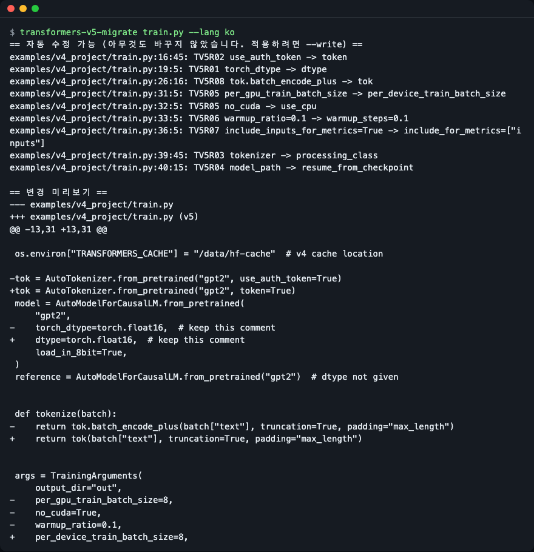
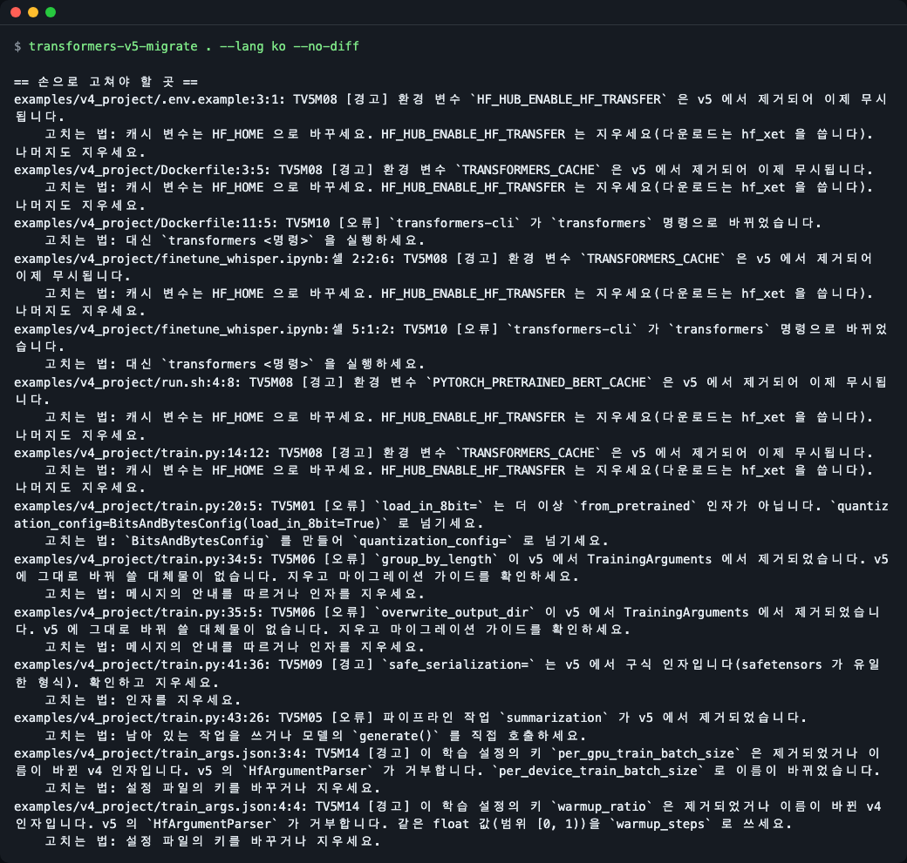
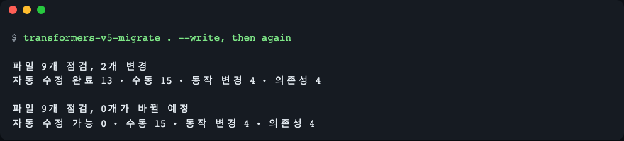
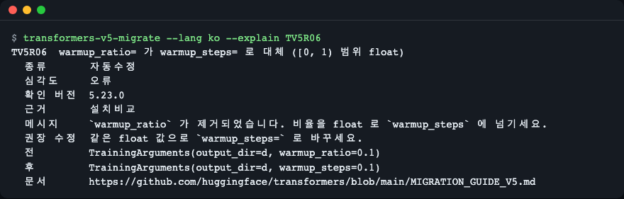
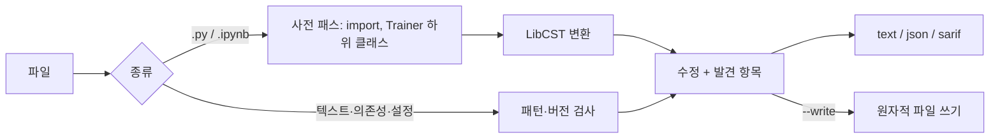

# transformers-v5-migrate

[English](README.md) | **한국어**

Hugging Face Transformers v4 코드(스크립트·노트북·의존성 파일)를 v5 로 옮길 때 쓰는 명령줄 코드 변환기 겸 위험 보고서입니다. 이름만 바뀐 것(`torch_dtype`→`dtype`, `use_auth_token`→`token`, `Trainer(tokenizer=)`→`processing_class=` 등)은 대신 고쳐 주고, 나머지는 규칙 ID·파일·줄·고치는 법과 함께 목록으로 보여 줍니다. `--write` 를 주지 않으면 아무것도 바꾸지 않습니다.


*v4 학습 스크립트를 미리보기로 돌린 화면: 자동으로 고칠 수 있는 항목과, `--write` 가 적용할 diff.*

## 이런 분께

- v4 학습·추론 스크립트, 파인튜닝 노트북, Dockerfile 이 있고 v5 로 올리기 전에 무엇이 깨지는지 알고 싶은 분
- v4 전용 코드가 들어오면 실패하는 CI·pre-commit 검사가 필요한 분
- 제거된 인자를 에러 메시지로 하나씩 만나고 싶지 않은 분

## 설치

```bash
# 한 번만: uv 설치 (https://docs.astral.sh/uv/)
curl -LsSf https://astral.sh/uv/install.sh | sh

# 설치 없이 실행 (Python 3.11+, libcst 와 packaging 만 설치됨. transformers 는 필요 없음)
uvx transformers-v5-migrate --version

# 또는 명령으로 설치
uv tool install transformers-v5-migrate
# 또는 소스에서
git clone https://github.com/LeeGyeongPil/transformers-v5-migrate && cd transformers-v5-migrate && uv sync
```

`pip install transformers-v5-migrate` 도 됩니다. 최소 리눅스 이미지에서는 `curl`, `git`, Python 3.11 이상이 필요합니다.

## 빠르게 시작하기

```bash
transformers-v5-migrate path/to/your/project
```

저장소를 받았다면 들어 있는 v4 예제 프로젝트로 해 볼 수 있습니다(`uv run transformers-v5-migrate ...` 로 실행):

```bash
uv run transformers-v5-migrate examples/v4_project --lang ko --color never --no-diff
```

출력(줄여서 실음. 전체는 자동 수정 13건·수동 15건·동작 변경 4건·의존성 4건):

```text
== 자동 수정 가능 (아무것도 바꾸지 않았습니다. 적용하려면 --write) ==
examples/v4_project/train.py:16:45: TV5R02 use_auth_token -> token
examples/v4_project/train.py:19:5: TV5R01 torch_dtype -> dtype
examples/v4_project/train.py:32:5: TV5R05 no_cuda -> use_cpu
examples/v4_project/train.py:39:45: TV5R03 tokenizer -> processing_class

== 손으로 고쳐야 할 곳 ==
examples/v4_project/train.py:20:5: TV5M01 [오류] `load_in_8bit=` 는 더 이상 `from_pretrained` 인자가 아닙니다. `quantization_config=BitsAndBytesConfig(load_in_8bit=True)` 로 넘기세요.
    고치는 법: `BitsAndBytesConfig` 를 만들어 `quantization_config=` 로 넘기세요.

== 의존성 파일 ==
examples/v4_project/requirements.txt:3:1: TV5D02 [경고] `huggingface_hub<1.0` 는 transformers 5.23.0 이 요구하는 `huggingface-hub>=1.31.0,<3.0` 와 함께 설치할 수 없습니다.
    고치는 법: huggingface-hub 고정을 `>=1.31.0,<3.0` 으로 푸세요.

파일 9개 점검, 2개가 바뀔 예정
자동 수정 가능 13 · 수동 15 · 동작 변경 4 · 의존성 4
```

읽는 법:

- 한 줄은 `경로:줄:열: 규칙ID` 입니다. 노트북은 `notebook.ipynb:셀 3:4:81` 처럼 셀 번호가 붙습니다.
- **자동 수정 가능**은 안전한 이름 바꾸기입니다. **수동**은 그대로 바꿔 쓸 대체가 없어 사람이 정해야 합니다. **동작 변경**은 v5 에서도 돌지만 결과가 달라집니다. **의존성**은 v5 를 막는 버전 고정입니다.
- 오류 수준 항목이 남아 있으면 종료 코드 1, 아니면 0 입니다.


*보고서 부분: 모든 항목에 규칙 ID·위치·심각도·고치는 법이 붙습니다.*

## 사용법

| 명령·옵션 | 하는 일 | 예 |
|---|---|---|
| `PATH ...` | 점검할 파일·폴더(`.py`, `.ipynb`, `requirements*.txt`, `pyproject.toml`, `environment.yml`, Dockerfile, `.env*`, 셸 스크립트, Makefile, JSON/YAML 학습 설정) | `transformers-v5-migrate src/ notebooks/` |
| *(기본)* | 미리보기: 보고서와 diff 만 보여 주고 쓰지 않음 | `transformers-v5-migrate .` |
| `--write` | 자동 수정을 `.py`·`.ipynb` 파일에만 적용 | `transformers-v5-migrate . --write` |
| `--no-diff` | diff 미리보기를 숨김 | `transformers-v5-migrate . --no-diff` |
| `--format text\|json\|sarif` | 출력 형식, `--output FILE` 은 파일로 저장 | `transformers-v5-migrate . --format sarif --output tv5m.sarif` |
| `--select` / `--ignore` | 이 규칙 ID·접두사만 쓰거나 건너뜀 | `--select TV5R,TV5M01` |
| `--exclude GLOB` | 맞는 파일·폴더를 건너뜀(여러 번 가능) | `--exclude "legacy/*"` |
| `--fail-on error\|warning\|note\|never` | 종료 코드 1 이 되는 가장 낮은 심각도(기본 `error`) | `--fail-on warning` |
| `--list-rules` | 규칙 표 출력 | `transformers-v5-migrate --list-rules` |
| `--explain RULE` | 규칙 하나를 전/후 예시와 함께 설명 | `transformers-v5-migrate --explain TV5R06` |
| `--lang en\|ko` | 출력 언어 | `transformers-v5-migrate . --lang ko` |

종료 코드: `0` `--fail-on` 이상 항목 없음, `1` 항목 있음, `2` 사용 오류 또는 점검할 파일 없음.

### 자동 수정 적용하기

```bash
transformers-v5-migrate . --write --no-diff
transformers-v5-migrate . --no-diff
```

예제 프로젝트를 임시 폴더에 복사해 돌리면 두 실행이 이렇게 끝납니다:

```text
파일 9개 점검, 2개 변경
자동 수정 완료 13 · 수동 15 · 동작 변경 4 · 의존성 4

파일 9개 점검, 0개가 바뀔 예정
자동 수정 가능 0 · 수동 15 · 동작 변경 4 · 의존성 4
```

두 번째 실행에는 자동으로 고칠 것이 더 없으므로 같은 명령을 다시 돌려도 결과가 같습니다(멱등). 수동·동작 변경·의존성 항목만 남습니다. 고칠 것 없는 파일은 건드리지 않고(바이트·수정 시각 그대로), CRLF 줄바꿈과 BOM 을 유지하며, 쓰기는 원자적으로 합니다.


*`--write` 뒤 두 번째 실행은 바뀔 파일 0개입니다. 사람이 봐야 할 항목만 남습니다.*

### 노트북

`.ipynb` 는 셀 단위로 검사합니다. `!pip install ...`, `%time trainer.train()`, `%%bash` 셀 같은 매직 줄은 파서에서 가렸다가 글자 그대로 복원하고, 출력과 메타데이터는 건드리지 않습니다. 파싱할 수 없는 셀은 `TV5P01` 로 보고하고 나머지를 계속 점검합니다.

### CI 와 pre-commit

SARIF 2.1.0 출력은 코드 스캐닝에 올릴 수 있습니다. pre-commit 은 `.pre-commit-config.yaml` 에 추가합니다:

```yaml
repos:
  - repo: https://github.com/LeeGyeongPil/transformers-v5-migrate
    rev: v0.1.0
    hooks:
      - id: transformers-v5-migrate          # v5 에서 깨질 것이 있으면 실패
      # - id: transformers-v5-migrate-fix    # 또는 자동 수정 적용
```

### 파이썬 API

```python
from transformers_v5_migrate import migrate_source

src = 'from transformers import AutoModel\nm = AutoModel.from_pretrained("gpt2", torch_dtype="auto")\n'
result = migrate_source(src, path="train.py")
print(result.code)                      # 기계적 수정이 적용된 코드
print([f.rule for f in result.fixes])   # ['TV5R01']
```

`migrate_notebook`, `scan_paths`, `RULES` 도 내보냅니다.

### 규칙 하나 살펴보기

```bash
transformers-v5-migrate --lang ko --explain TV5R06
```

```text
TV5R06  warmup_ratio= 가 warmup_steps= 로 대체 ([0, 1) 범위 float)
  종류       자동수정
  심각도     오류
  확인 버전  5.23.0
  근거       설치비교
  메시지     `warmup_ratio` 가 제거되었습니다. 비율을 float 로 `warmup_steps` 에 넘기세요.
  권장 수정  같은 float 값으로 `warmup_steps=` 로 바꾸세요.
  전         TrainingArguments(output_dir=d, warmup_ratio=0.1)
  후         TrainingArguments(output_dir=d, warmup_steps=0.1)
  문서       https://github.com/huggingface/transformers/blob/main/MIGRATION_GUIDE_V5.md
```


*`--explain` 은 규칙이 하는 일, 확인 정도, 전/후 예시를 보여 줍니다.*

## 설정

| 설정 | 뜻 |
|---|---|
| `--lang en\|ko` | 출력 언어. 우선순위 가장 높음. |
| `TRANSFORMERS_V5_MIGRATE_LANG` | `--lang` 이 없을 때의 언어. |
| `LC_ALL`, `LC_MESSAGES`, `LANG` | 그다음 이 순서로(처음 비어 있지 않은 값). `ko` 로 시작하면 한국어, 아니면 영어. |
| `NO_COLOR` | 색 출력을 끔(`--color always\|never\|auto` 가 우선). |

규칙 ID·JSON 키·SARIF 구조는 언어와 무관하고 메시지만 바뀝니다. 연습용 목(mock) 모드는 없습니다. 이 도구는 정적 분석이라 여러분의 코드를 import 하거나 실행하지 않습니다.

## 동작 원리



- 첫 패스에서 어떤 이름이 `transformers` 에서 왔는지, 어떤 클래스가 `Trainer` 를 상속하는지 모읍니다. `transformers` 를 import 하지 않는 파일은 건너뛰므로 여러분의 클래스에 있는 `tokenizer=` 인자는 그대로 둡니다.
- 두 번째 패스는 LibCST 로 구문 트리를 고쳐 주석과 서식을 지킵니다. `import transformers as tf`, `Trainer as HFTrainer` 같은 별칭도 따라갑니다.
- 값의 의미가 바뀌는 이름 변경은 조건부입니다. 예를 들어 `warmup_ratio` 는 0 이상 1 미만 숫자 리터럴일 때만 고치고, 아니면 보고합니다.
- 의존성 파일·Dockerfile·`.env` 는 검사만 하고 다시 쓰지 않습니다.
- 규칙 표는 transformers 4.57.1 과 5.23.0 을 실제로 설치해 비교한 결과(`data/v5_surface.json`)와 맞춥니다. 제거된 `TrainingArguments` 필드에 규칙이 없으면 테스트가 실패합니다. 통합 테스트는 5.23.0 을 설치해 원본 코드는 오류(`no_cuda` 는 `TypeError`, `encode_plus` 는 `AttributeError`)를 내고 변환한 코드는 동작함을 보입니다.

## 공식 가이드와 다른 점

규칙은 설치한 패키지로 확인했습니다(확인일 2026-11-17).

- 가이드는 `encode_plus` 를 deprecated 로 적었지만 5.23.0 은 `AttributeError` 를 냅니다.
- 제거된 `TrainingArguments` 필드 5개는 가이드에 없습니다(`adafactor`, `fp16_opt_level`, `group_by_length`, `save_safetensors`, `torchdynamo`). 규칙 `TV5M06` 이 보고합니다.
- `except requests.HTTPError` 는 가이드가 `httpx` 를 안내하지만, 여기서 쓴 5.23.0 환경에는 `httpx` 가 설치되지 않았고 `huggingface_hub.errors.HfHubHTTPError` 가 있어서 `TV5M13` 은 그것을 권합니다.

출처: [Transformers v5 마이그레이션 가이드](https://github.com/huggingface/transformers/blob/main/MIGRATION_GUIDE_V5.md), 2026-11-17 확인.

## 언제 쓰나

- 잘 맞는 때: `transformers` 를 v5 로 올리기 전 코드베이스를 한 번 훑을 때, 올린 뒤 CI 에서 v4 코드가 다시 들어오는 것을 막을 때.
- 한계: 정적 분석이라 딕셔너리를 `TrainingArguments(**cfg)` 로 넘기면 키만 경고하고, 다른 파일에 정의한 `Trainer` 하위 클래스는 알아보지 못할 수 있으며, TRL 같은 다운스트림 라이브러리는 범위 밖입니다. 규칙 기준은 5.23.0 입니다.
- 다른 선택: 변경 전체 목록은 공식 [마이그레이션 가이드](https://github.com/huggingface/transformers/blob/main/MIGRATION_GUIDE_V5.md), 직접 코드 변환기를 만들려면 [LibCST](https://github.com/Instagram/LibCST).

## 자주 겪는 문제

| 증상 | 원인 | 해결 |
|---|---|---|
| 종료 코드가 1 인데 바뀐 것이 없음 | 기본은 미리보기이고 수동 오류가 남아 있음 | `--write` 로 자동 수정을 적용하고 수동 항목을 처리 |
| 파일이 `TV5P01` 로 나옴 | 파일·노트북 셀이 올바른 파이썬이 아님 | 문법을 고치세요. 다른 파일은 계속 점검됩니다. `transformers` 를 언급하지 않는 파일은 참고(note)만 남아 CI 가 실패하지 않습니다 |
| `경로가 없습니다`, 종료 코드 2 | 준 경로가 틀림 | 철자와 현재 폴더 확인 |
| `점검할 파일이 없습니다`, 종료 코드 2 | 폴더에 지원하는 파일이 없거나 `--exclude` 가 모두 제외함 | 경로와 `--exclude` 패턴 확인 |
| 영어로 보고 싶은데 한국어로 나옴 | `LANG` 이 `ko` 로 시작 | `--lang en` 또는 `TRANSFORMERS_V5_MIGRATE_LANG=en` |
| 노트북 수정이 `git diff` 에 잘 안 보임 | 바뀐 셀의 `source` 줄만 달라짐 | 그 줄의 JSON diff 를 보세요 |
| 괜찮은 호출에 경고가 나옴 | 이름 기반 검사임 | `--ignore TV5xxx` 로 그 규칙만 끔 |

## 개발·기여

```bash
uv sync
uv run pytest -q
# 실제 transformers 5.23.0 설치로 하는 통합 테스트 (torch 불필요)
uv run --with "transformers==5.23.0" pytest -q -m integration tests/integration
```

버그·제안은 이슈로 남겨 주세요. 변경 기록은 [CHANGELOG.md](CHANGELOG.md). 규칙 스냅샷을 더 새로운 5.x 와 비교하려면 두 버전을 임시 환경에 설치해 비교하세요(스크립트 docstring 참고).

```bash
uv venv -q --python 3.12 /tmp/tv4 && uv pip install -q --python /tmp/tv4/bin/python "transformers==4.57.1"
uv venv -q --python 3.12 /tmp/tv5 && uv pip install -q --python /tmp/tv5/bin/python "transformers>=5"
uv run python scripts/refresh_surface.py --v4-python /tmp/tv4/bin/python --v5-python /tmp/tv5/bin/python --check
```

## 크레딧

- [LibCST](https://github.com/Instagram/LibCST) (MIT): 주석과 서식을 유지하며 코드를 분석·변환합니다.
- 규칙과 `data/v5_surface.json` 의 API 이름 목록은 Transformers [v5 마이그레이션 가이드](https://github.com/huggingface/transformers/blob/main/MIGRATION_GUIDE_V5.md)와 4.57.1·5.23.0 릴리스 비교를 바탕으로 합니다(Apache-2.0).

## 라이선스

MIT, [LICENSE](LICENSE) 참고.
