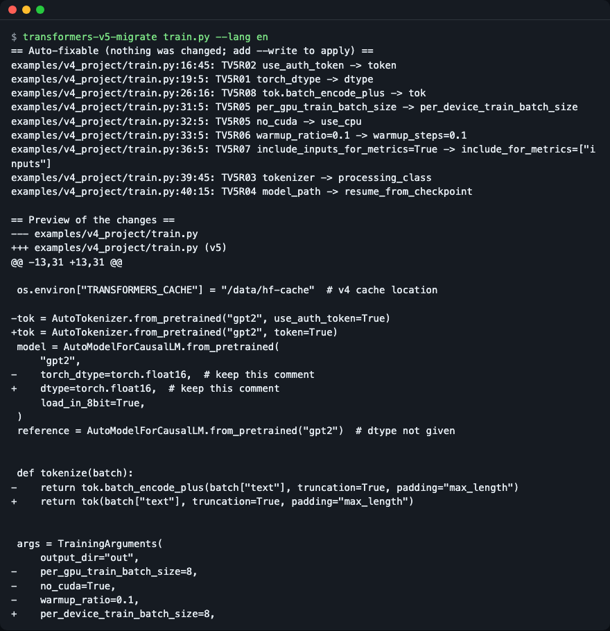
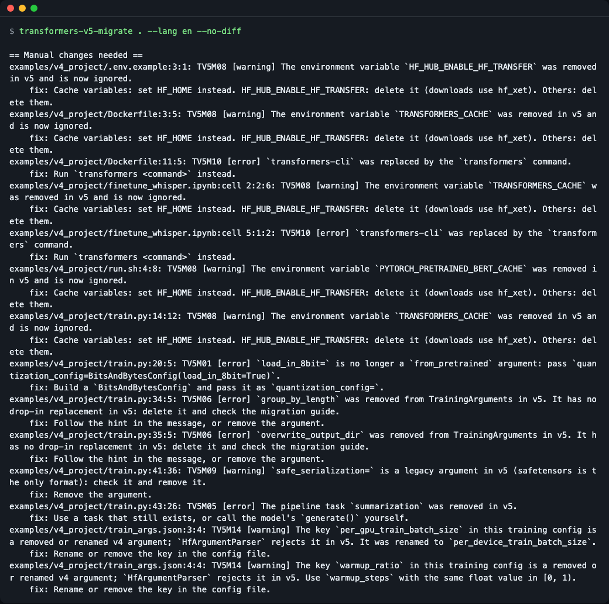
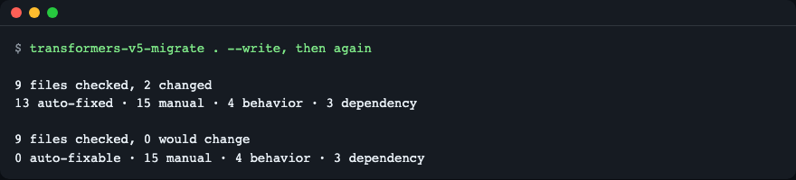
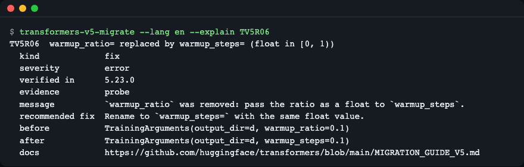
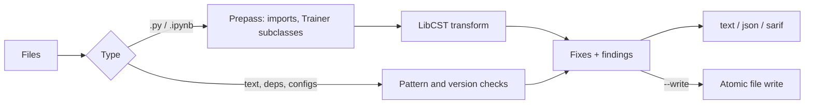

# transformers-v5-migrate

**English** | [한국어](README.ko.md)

A command-line codemod and risk report for moving Hugging Face Transformers v4 code (scripts, notebooks, dependency files) to v5. It rewrites the mechanical renames for you (`torch_dtype` to `dtype`, `use_auth_token` to `token`, `Trainer(tokenizer=)` to `processing_class=`, and more) and lists everything else with a rule ID, file, line and the fix. Nothing is changed unless you pass `--write`.


*A dry run on a v4 training script: the findings that can be fixed automatically, then the diff that `--write` would apply.*

## Who it is for

- You have a v4 training or inference script, a fine-tuning notebook, or a Dockerfile, and you want to know what breaks on v5 before you upgrade.
- You want a CI or pre-commit gate that fails when v4-only code shows up.
- You would rather not discover removed arguments one traceback at a time.

## Install

```bash
# one-time: install uv (https://docs.astral.sh/uv/)
curl -LsSf https://astral.sh/uv/install.sh | sh

# run without installing (Python 3.11+, installs only libcst and packaging; transformers is NOT needed)
uvx transformers-v5-migrate --version

# or install the command
uv tool install transformers-v5-migrate
# or from source
git clone https://github.com/LeeGyeongPil/transformers-v5-migrate && cd transformers-v5-migrate && uv sync
```

`pip install transformers-v5-migrate` works as well. On a minimal Linux image you need `curl`, `git` and Python 3.11 or newer.

## Quick start

```bash
transformers-v5-migrate path/to/your/project
```

From a clone you can try the bundled v4 sample project (use `uv run transformers-v5-migrate ...` instead):

```bash
uv run transformers-v5-migrate examples/v4_project --lang en --color never --no-diff
```

Output (shortened; the full run lists 13 fixes, 15 manual items, 4 behavior notes and 3 dependency notes):

```text
== Auto-fixable (nothing was changed; add --write to apply) ==
examples/v4_project/train.py:16:45: TV5R02 use_auth_token -> token
examples/v4_project/train.py:19:5: TV5R01 torch_dtype -> dtype
examples/v4_project/train.py:32:5: TV5R05 no_cuda -> use_cpu
examples/v4_project/train.py:39:45: TV5R03 tokenizer -> processing_class

== Manual changes needed ==
examples/v4_project/train.py:20:5: TV5M01 [error] `load_in_8bit=` is no longer a `from_pretrained` argument: pass `quantization_config=BitsAndBytesConfig(load_in_8bit=True)`.
    fix: Build a `BitsAndBytesConfig` and pass it as `quantization_config=`.

== Dependency files ==
examples/v4_project/constraints.txt:3:1: TV5D02 [warning] `huggingface_hub<1.0` cannot be installed together with transformers 5.23.0, which needs `huggingface-hub>=1.31.0,<3.0`.
    fix: Relax the huggingface-hub pin to `>=1.31.0,<3.0`.

9 files checked, 2 would change
13 auto-fixable · 15 manual · 4 behavior · 3 dependency
```

How to read it:

- Each line is `path:line:column: RULE`. In a notebook the path reads `notebook.ipynb:cell 3:4:81`.
- **Auto-fixable** items are safe renames. **Manual** items have no drop-in replacement, so you decide. **Behavior** items still run on v5 but give different results. **Dependency** items are version pins that exclude v5.
- The exit code is 1 when an error-level item is open, 0 otherwise.


*The report part of the output: every item carries a rule ID, location, severity and the way to fix it.*

## Usage

| Command / option | What it does | Example |
|---|---|---|
| `PATH ...` | Files or folders to check (`.py`, `.ipynb`, `requirements*.txt`, `constraints*.txt`, `pyproject.toml`, `environment.yml`, Dockerfiles, `.env*`, shell scripts, Makefiles, JSON/YAML training configs) | `transformers-v5-migrate src/ notebooks/` |
| *(default)* | Dry run: report plus diff, nothing is written | `transformers-v5-migrate .` |
| `--write` | Apply the automatic fixes to `.py` and `.ipynb` files only | `transformers-v5-migrate . --write` |
| `--no-diff` | Hide the diff preview | `transformers-v5-migrate . --no-diff` |
| `--format text\|json\|sarif` | Output format; `--output FILE` writes it to a file | `transformers-v5-migrate . --format sarif --output tv5m.sarif` |
| `--select` / `--ignore` | Only or never use these rule IDs or prefixes | `--select TV5R,TV5M01` |
| `--exclude GLOB` | Skip matching files or folders (repeatable) | `--exclude "legacy/*"` |
| `--fail-on error\|warning\|note\|never` | Lowest severity that makes the exit code 1 (default `error`) | `--fail-on warning` |
| `--list-rules` | Print the rule table | `transformers-v5-migrate --list-rules` |
| `--explain RULE` | One rule with a before/after example | `transformers-v5-migrate --explain TV5R06` |
| `--lang en\|ko` | Output language | `transformers-v5-migrate . --lang ko` |

Exit codes: `0` nothing at or above `--fail-on`, `1` findings, `2` usage error or no files to check.

### Apply the fixes

```bash
transformers-v5-migrate . --write --no-diff
transformers-v5-migrate . --no-diff
```

On the sample project (copied to a temporary folder) the two runs end like this:

```text
9 files checked, 2 changed
13 auto-fixed · 15 manual · 4 behavior · 3 dependency

9 files checked, 0 would change
0 auto-fixable · 15 manual · 4 behavior · 3 dependency
```

The second run finds nothing left to fix automatically, so the command is idempotent. Only the manual, behavior and dependency items remain. Files with nothing to fix are not touched (bytes and modification time stay the same), CRLF line endings and BOMs are kept, and writes are atomic.


*After `--write` the second run reports 0 would change; only items that need a human remain.*

### Notebooks

`.ipynb` files are checked cell by cell. Magic lines such as `!pip install ...`, `%time trainer.train()` and `%%bash` cells are hidden from the parser and restored character for character; outputs and metadata are left alone. A cell that cannot be parsed is reported as `TV5P01` and the rest continues.

### CI and pre-commit

SARIF 2.1.0 output can be uploaded to code scanning. For pre-commit, add to `.pre-commit-config.yaml`:

```yaml
repos:
  - repo: https://github.com/LeeGyeongPil/transformers-v5-migrate
    rev: v0.1.1
    hooks:
      - id: transformers-v5-migrate          # fail when something would break on v5
      # - id: transformers-v5-migrate-fix    # or: apply the automatic fixes
```

### Python API

```python
from transformers_v5_migrate import migrate_source

src = 'from transformers import AutoModel\nm = AutoModel.from_pretrained("gpt2", torch_dtype="auto")\n'
result = migrate_source(src, path="train.py")
print(result.code)                      # code with the mechanical fixes applied
print([f.rule for f in result.fixes])   # ['TV5R01']
```

`migrate_notebook`, `scan_paths` and `RULES` are exported too.

### Look at one rule

```bash
transformers-v5-migrate --lang en --explain TV5R06
```

```text
TV5R06  warmup_ratio= replaced by warmup_steps= (float in [0, 1))
  kind             fix
  severity         error
  verified in      5.23.0
  evidence         probe
  message          `warmup_ratio` was removed: pass the ratio as a float to `warmup_steps`.
  recommended fix  Rename to `warmup_steps=` with the same float value.
  before           TrainingArguments(output_dir=d, warmup_ratio=0.1)
  after            TrainingArguments(output_dir=d, warmup_steps=0.1)
  docs             https://github.com/huggingface/transformers/blob/main/MIGRATION_GUIDE_V5.md
```


*`--explain` shows what a rule does, how sure we are, and a before/after pair.*

## Configuration

| Setting | Meaning |
|---|---|
| `--lang en\|ko` | Output language. Highest priority. |
| `TRANSFORMERS_V5_MIGRATE_LANG` | Language when `--lang` is absent. |
| `LC_ALL`, `LC_MESSAGES`, `LANG` | Used next, in this order (the first non-empty one). A value starting with `ko` gives Korean, anything else English. |
| `NO_COLOR` | Turns colored output off (`--color always\|never\|auto` wins). |

Rule IDs, JSON keys and the SARIF structure do not change with the language; only messages do. There is no mock mode: the tool is static analysis and never imports or runs your code.

## How it works



- A first pass collects which names come from `transformers` and which classes subclass `Trainer`. Files that never import `transformers` are skipped, so a `tokenizer=` argument on your own class is left alone.
- The second pass uses LibCST, which edits the syntax tree and keeps comments and formatting. Aliases such as `import transformers as tf` or `Trainer as HFTrainer` are followed.
- Renames that change meaning are conditional. For example `warmup_ratio` is only rewritten when it is a numeric literal in [0, 1); otherwise it is reported.
- Dependency files, Dockerfiles and `.env` files are only inspected, never rewritten.
- The rule table is checked against real installs of transformers 4.57.1 and 5.23.0 (`data/v5_surface.json`). Tests fail if a removed `TrainingArguments` field has no rule. Integration tests install 5.23.0 and show that the original code raises (`TypeError` for `no_cuda`, `AttributeError` for `encode_plus`) and the converted code works.

## Where it differs from the official guide

The rules were checked against installed packages, checked 2026-11-17:

- `encode_plus` is described as deprecated in the guide, but 5.23.0 raises `AttributeError`.
- Five removed `TrainingArguments` fields are not in the guide (`adafactor`, `fp16_opt_level`, `group_by_length`, `save_safetensors`, `torchdynamo`); rule `TV5M06` reports them.
- For `except requests.HTTPError` the guide points to `httpx`; in the 5.23.0 environment used here `httpx` was not installed and `huggingface_hub.errors.HfHubHTTPError` exists, so `TV5M13` recommends that.

Source: [Transformers v5 migration guide](https://github.com/huggingface/transformers/blob/main/MIGRATION_GUIDE_V5.md), read 2026-11-17.

## When to use it

- Good fit: a first sweep over a codebase before bumping `transformers` to v5, and a CI gate afterwards.
- Limits: it is static, so `TrainingArguments(**cfg)` with a dictionary is only flagged by key, a `Trainer` subclass defined in another file may not be recognized, and downstream libraries such as TRL are out of scope. Rules target 5.23.0.
- Other options: the official [migration guide](https://github.com/huggingface/transformers/blob/main/MIGRATION_GUIDE_V5.md) for the full list of changes, and [LibCST](https://github.com/Instagram/LibCST) if you want to write your own codemod.

## Troubleshooting

| Symptom | Cause | Fix |
|---|---|---|
| Exit code 1 but nothing was changed | Dry run is the default and manual errors are still open | Add `--write` for the automatic fixes, then handle the manual items |
| A file is listed as `TV5P01` | The file or notebook cell is not valid Python | Fix the syntax; the other files are still checked. Files that do not mention `transformers` get a note only, so CI does not fail |
| `path does not exist` and exit code 2 | The path you gave is wrong | Check the spelling and the working directory |
| `no files to check under` and exit code 2 | The folder holds no supported file, or `--exclude` removed all | Check the path and `--exclude` patterns |
| Output is Korean on your machine | `LANG` starts with `ko` | Pass `--lang en` or set `TRANSFORMERS_V5_MIGRATE_LANG=en` |
| Notebook edits seem missing in `git diff` | Only the `source` lines of changed cells differ | Look at the JSON diff of those lines |
| A warning about a call that is fine | The check is name based | Silence one rule with `--ignore TV5xxx` |

## Development

```bash
uv sync
uv run pytest -q
# integration tests against a real transformers 5.23.0 install (no torch needed)
uv run --with "transformers==5.23.0" pytest -q -m integration tests/integration
```

Bugs and suggestions are welcome as issues. See [CHANGELOG.md](CHANGELOG.md) for changes. To check the rule snapshot against a newer 5.x release, install both versions into throw-away environments and compare them (see the script's docstring):

```bash
uv venv -q --python 3.12 /tmp/tv4 && uv pip install -q --python /tmp/tv4/bin/python "transformers==4.57.1"
uv venv -q --python 3.12 /tmp/tv5 && uv pip install -q --python /tmp/tv5/bin/python "transformers>=5"
uv run python scripts/refresh_surface.py --v4-python /tmp/tv4/bin/python --v5-python /tmp/tv5/bin/python --check
```

## Credits

- [LibCST](https://github.com/Instagram/LibCST) (MIT) parses and rewrites the code while keeping comments and formatting.
- The rules and the API name lists in `data/v5_surface.json` are based on the Transformers [v5 migration guide](https://github.com/huggingface/transformers/blob/main/MIGRATION_GUIDE_V5.md) and on comparing the 4.57.1 and 5.23.0 releases (Apache-2.0).

## License

MIT, see [LICENSE](LICENSE).
